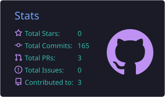
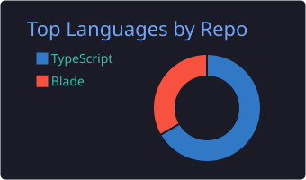
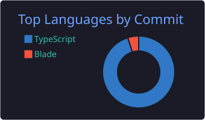
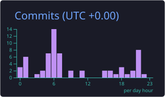

<!-- ===================== HEADER ===================== -->

  

  

 

<!-- HERO GIF (original) -->

  

 

  
  
  

 

  
  
  

 

---

<!-- ===================== SOBRE ===================== -->

## 👋 Um pouco sobre mim

Sou **desenvolvedor Full Stack** de **Manaus – AM 🇧🇷**, com mais de **4 anos** criando sistemas que funcionam de verdade, do chão de fábrica ao dashboard na tela.

Gosto de unir **código limpo**, **boa performance** e **entrega de valor real**. Minha praia é a **Indústria 4.0**: sensores, dados em tempo real e APIs que ajudam empresas a tomarem decisões melhores.

 

---

<!-- ===================== EM NÚMEROS ===================== -->
## ⚡ Resumo rápido

| 🗓️ Experiência | 🏭 Especialidade | 📉 Impacto | 🌐 Idiomas |
|:---:|:---:|:---:|:---:|
| **+4 anos** | **Indústria 4.0 & IoT** | **-50%** erros operacionais | PT (nativo) • EN (B1/B2) |

---

<!-- ===================== STACK ===================== -->
## 🛠️ Tech Stack

**💻 Linguagens** 

**🎨 Frontend** 

**⚙️ Backend** 

**🗄️ Bancos de dados** 
 

**🚀 DevOps & Cloud** 

**🏭 IoT & Mensageria** 
 

**🧰 Ferramentas** 

---

<!-- ===================== EXPERIÊNCIA ===================== -->
## 💼 Experiência Profissional

### 🏢 Instituto Venturus — Full Stack Developer
> Aplicações industriais e corporativas em projetos de P&D voltados à Indústria 4.0

<b>🏭 Projeto OEE (Overall Equipment Effectiveness)</b>

 

- APIs escaláveis em **.NET (C#)** para monitorar a eficiência industrial
- Cálculo de **disponibilidade, performance e qualidade**
- 📉 **Redução de 50%** na taxa de erros operacionais
- 🏆 Reconhecido como desenvolvedor de melhor desempenho

<b>📊 Projeto SPGEC (Planejamento e Gestão de Equipamentos)</b>

 

- APIs e dashboards integrados com **.NET (C#)** e **React.js**
- **Repository Pattern** e **Dependency Injection** para escalabilidade
- Integração com **sensores IoT** e otimização de queries SQL

**Stack:** `React.js` `TypeScript` `Node.js` `.NET (C#)` `PostgreSQL` `Oracle` `MariaDB` `MQTT`

 

### 🏢 MAP Innovation — Frontend Developer

<b>Ver detalhes</b>

 

- Dashboards industriais em **tempo real**
- Integração de APIs RESTful com foco em performance
- Aplicação de princípios de **UI/UX**
- Componentes reutilizáveis e **testes automatizados**

**Stack:** `React.js` `TypeScript` `API RESTful`

 

### 🏢 Builderall — Full Stack Developer

<b>Ver detalhes</b>

 

- Plataformas **SaaS** nas áreas de educação, design e marketing
- APIs RESTful com autenticação **JWT** e controle de acesso
- Otimização de bancos **MariaDB** para alto tráfego
- **CI/CD** com Docker e Kubernetes

**Stack:** `React.js` `Node.js` `MariaDB` `Docker` `Kubernetes`

---

<!-- ===================== CONQUISTAS ===================== -->
## 🏆 Conquistas

| 🎯 | Destaque |
|:---:|:---|
| ✨ | **50% de redução** em erros operacionais no Projeto OEE |
| 🥇 | **Desenvolvedor destaque** no Instituto Venturus |
| 🏭 | Sistemas críticos para **Indústria 4.0** |
| ⚡ | APIs de **alta performance** com dados em tempo real |

---

<!-- ===================== STATS ===================== -->
## 📊 GitHub em números

  

 

  
  

  
  

 

  <picture>
    <source media="(prefers-color-scheme: dark)" srcset="https://raw.githubusercontent.com/devlucas2A/devlucas2A/output/github-contribution-grid-snake-dark.svg"/>
    <source media="(prefers-color-scheme: light)" srcset="https://raw.githubusercontent.com/devlucas2A/devlucas2A/output/github-contribution-grid-snake.svg"/>
 
  </picture>

---

<!-- ===================== CONTATO ===================== -->
## 📫 Vamos conversar?

💼 **Aberto a novas oportunidades**
📍 Manaus – Amazonas – Brasil

 

 

